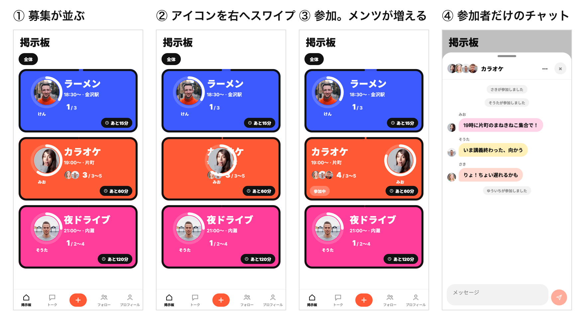
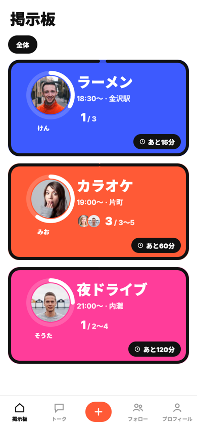
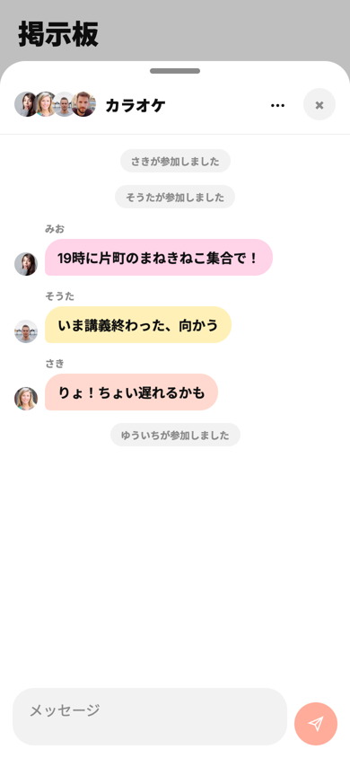
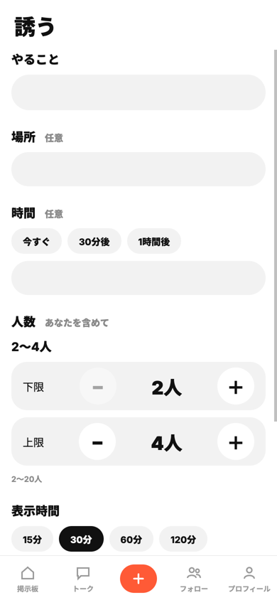

# このゆびとまれ

**「今から遊ばない？」を、LINE で一人ずつ誘わずに。** 募集を出すと友達の掲示板に並び、行ける人だけが主催者のアイコンを右にスワイプして参加します。断る操作はなく、締切が来れば募集は自然に消えます。

**デモ: https://kz2611.pages.dev** （スマートフォンのブラウザ向け。PC では中央にスマホ幅で表示）

## 審査員の方へ：試し方（2〜3分）
友達同士で使うアプリのため、**ブラウザを2つ**（例: スマホと PC、または通常ウィンドウとシークレットウィンドウ）使ってください。

1. A・B それぞれで「登録する」（ID・名前・8文字以上のパスワード）
2. A の「フォロー」に出る招待リンクを B で開く（または QR を読む）→ 友達になる
3. A の中央の「＋（誘う）」で、やること・人数（例 2〜4人）・表示時間を選んで公開
4. B の掲示板にカードが出る。**主催者のアイコンを右へスワイプ**して参加 → A の画面でも人数リングが増える
5. カードをタップするとチャットが開く（参加者だけが読める）。アイコンを左へスワイプすると参加取り消し
6. 上限の人数がそろうと募集は自動で終了し、掲示板から消える（トークには残る）

## 製品概要
### 背景（製品開発のきっかけ、課題等）
「ちょっと遊びたい」とき、大学生は LINE の DM やグループで誘うのをためらいます。チームのアイデア出しで挙がった具体的な理由は次の4つです（[元のアイデアマップ](docs/sources/idea-map.jpg)）。

| 誘う前にためらう理由 | 具体的には |
|---|---|
| 個別に誘いづらい | 暇か聞くだけの連絡を送りにくい |
| 返信のラグ | 気づかない／様子見で返さない／一番手で断りたくない |
| 断る・集まらない気まずさ | 断りづらい、誰も来ないと悲しい |
| メンツが分からない | 誰が来るか分からないと行きにくい。人が集まるなら行く |

### 製品説明（具体的な製品の説明）
| 理由 | このゆびとまれでの解き方 |
|---|---|
| 個別に誘いづらい | 一人ずつ誘わず、友達全体かグループに**募集を出すだけ** |
| 返信のラグ | 返事を待たない。**表示時間（15〜120分）が過ぎれば自然に消える** |
| 断る気まずさ | **断るボタンがない**。行ける人だけがスワイプする。人数がそろえば自動で締切 |
| メンツが分からない | カードに**参加者のアイコンと人数（例 3 / 3〜5）**。参加前に誰が来るか見える |

| 掲示板 | チャット | 誘う |
|---|---|---|
|  |  |  |

### 特長
#### 1. 主催者のアイコンを右へスワイプするだけで参加
「行く」と送るのではなく、主催者の丸を指で右へ動かす。参加するとアイコンが右、内容が左に入れ替わり、参加済みが一目で分かる。左へ戻せば取り消し。主催者は左へスワイプで掲示を取り消せる（確認つき）。

#### 2. 2つのゲージで「あと何分・あと何人」
カードの外枠が残り時間（時計回りに減り、残り10分で黄色）、主催者アイコンの縁が集まった人数。文字を読まなくても締切と集まり具合が分かる。

#### 3. 気まずさが残らない終わり方
断る操作がない／表示時間で自然に消える／上限の人数で自動終了。満員の募集は、参加していない人の掲示板から消える。

### 解決出来ること
- 一人ずつ誘う代わりに、友達やグループへ一度に声をかけられる
- 返信を待たずに、行ける人だけで集まりが決まる
- 断らなくてよいので、誘う側も誘われる側も気が楽
- 参加前にメンツと人数が分かる

### 今後の展望
- 利用テスト: 同じ「今から30分ご飯」を LINE と本アプリで誘ってもらい、参加が決まるまでの時間と気まずさを比べる（**未実施**）
- アプリを閉じている相手にも届くプッシュ通知（今はアプリを開いたときに最新の募集が見える）
- iOS / Android アプリとしての配布（Expo で同じコードから作れる構成）

### 注力したこと（こだわり等）
* **指で操作する前提の UI**: スワイプとタップ・縦スクロールの区別、親指で届く下タブ中央の「誘う」、入力時に画面が拡大されない文字サイズ
* **見えてはいけない人には見せない**: 募集・チャット・プロフィールを見てよいかは画面ではなくサーバー側で判定（友達か、グループのメンバーか、参加者か）
* **同時に押されても壊れない**: 残り1枠に2人が同時に参加しても、定員を超えない
* **チーム開発の仕組み**: Issue → PR → CI（型チェック・フロント33件・API 7ファイルのテスト）→ main へのマージで自動公開。チームメンバーが Issue で仕様を出し、AI エージェントで並行実装した

## 開発技術
### 活用した技術
#### API・データ
* Cloudflare Pages Functions（API）
* Cloudflare D1（SQLite）
* Web Crypto API（パスワードの PBKDF2 ハッシュ）

#### フレームワーク・ライブラリ・モジュール
* Expo / React Native / React / TypeScript
* react-native-web（同じコードを Web で動かす）
* react-native-svg（ゲージ・アイコン）、expo-image-picker / expo-image-manipulator（写真の切り取り）
* GitHub Actions（CI と自動公開）

#### デバイス
* スマートフォン・PC の Web ブラウザ

### 独自技術
#### ハッカソンで開発した独自機能・技術
* **スワイプで参加・取り消し・掲示取り消しを切り替えるカード**: 参加状態で主催者アイコンの位置と使える操作が変わり、処理中・失敗時は元の位置に戻る — [`app/src/components/EventCard.tsx`](app/src/components/EventCard.tsx)（[#38](https://github.com/jphacks/kz_2611/pull/38) [#52](https://github.com/jphacks/kz_2611/pull/52) [#55](https://github.com/jphacks/kz_2611/pull/55)）
* **定員と自動終了を1回の処理で判定**: 参加の追加は「今の人数が上限未満のときだけ」挿入する1つの SQL で行い、上限に達したら同じ処理の中で募集を終了する。同時参加でも定員を超えない — [`app/functions/lib/events.ts`](app/functions/lib/events.ts)（[#16](https://github.com/jphacks/kz_2611/pull/16) [#49](https://github.com/jphacks/kz_2611/pull/49) [#75](https://github.com/jphacks/kz_2611/pull/75)）。テスト: [`app/scripts/tests/test_events.py`](app/scripts/tests/test_events.py)
* **見てよい人の判定をサーバーに集約**: 主催者・参加者・友達（全体公開）・グループのメンバーだけが募集を見られる — [`app/functions/lib/core.ts`](app/functions/lib/core.ts) の `visibleSql`
* **2つのゲージ**: 角丸の外枠を時計回りに減らす残り時間ゲージと、人数リング — [`app/src/components/EventCard.tsx`](app/src/components/EventCard.tsx)（[#38](https://github.com/jphacks/kz_2611/pull/38) [#60](https://github.com/jphacks/kz_2611/pull/60)）

### 確認したこと／まだ確認していないこと
- 確認済み: CI（型チェック、フロントのテスト33件、API テスト7ファイル、定員の同時参加を含む境界テスト）、スマホ幅（390px）のブラウザでのタッチ操作（スワイプで参加・取り消し、チャット送信）、公開版の DB 接続
- 未確認: iOS / Android の実機アプリ、ユーザーテストによる効果（上の「今後の展望」）

---
開発者向けの情報（起動方法・開発ルール）は [CONTRIBUTING.md](CONTRIBUTING.md) にあります。
