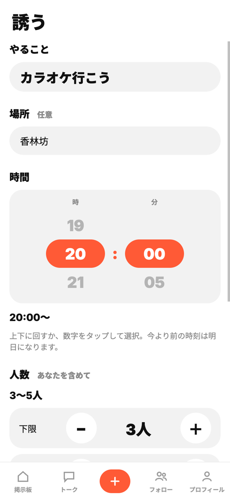
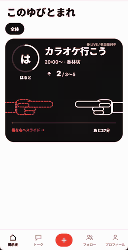
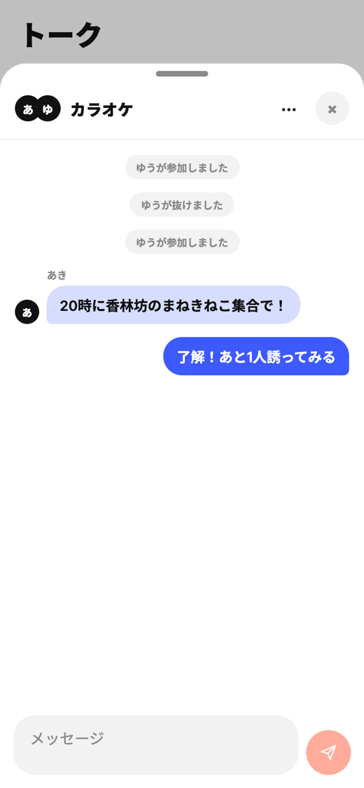
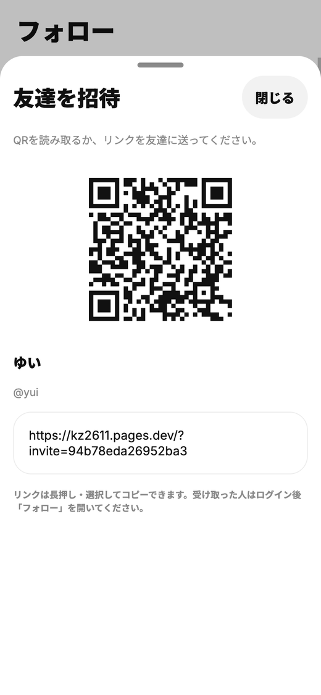
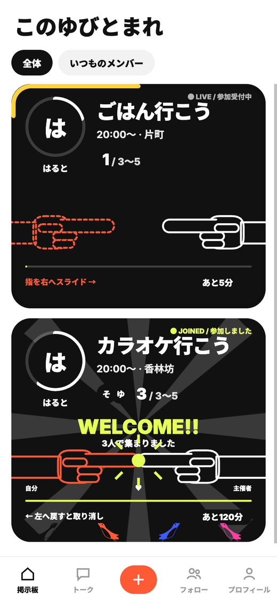
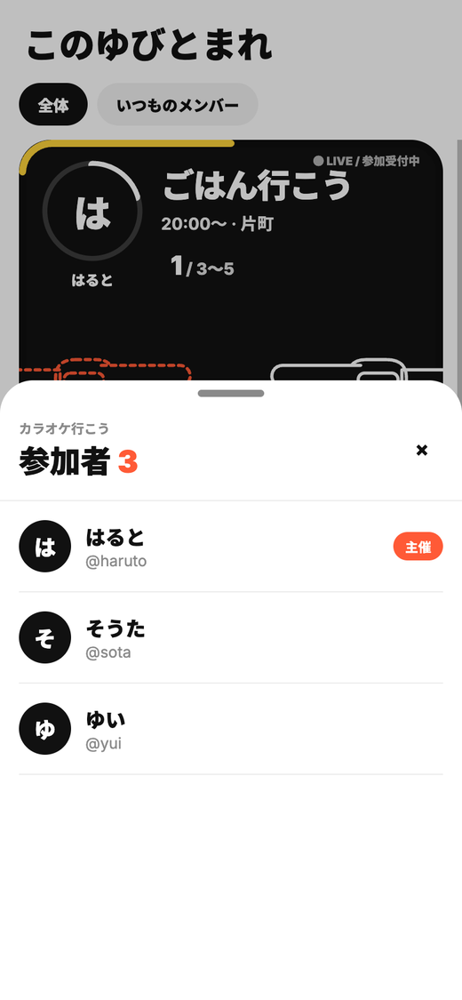

# このゆびとまれ

  
  
  
  
  

フッ軽遊びをもっと気軽に。LINE で誘いづらい「ちょっと遊びたい」を、募集・応募の形式で解決する Web アプリです。

**▶ アプリを使ってみる: https://kz2611.pages.dev**

<table>
  <tr>
    <td align="center"></td>
    <td align="center"></td>
    <td align="center"></td>
  </tr>
  <tr>
    <td align="center">① 誘う</td>
    <td align="center">② 指をスライドして参加</td>
    <td align="center">③ 参加者だけでチャット</td>
  </tr>
</table>

## 製品概要
### 背景(製品開発のきっかけ、課題等）
大学生・若者は友達と「ちょっと遊びたい」と思ったとき、LINE の個別チャットやグループでメッセージを送らないといけません。しかし、相手の都合が合わないときに別の人を探す手間がかかります。また、返信を返す側もメッセージに気づくまでにタイムラグが発生したり、都合が合わない時に断りづらさを感じたりします。遊び募集の温度感や返信の文面を考えるうちに参加を見送ってしまうこともあります。
このように「ちょっと遊びたい」時に誘う側も誘われる側にも負担が生じ、遊びが成立しにくいという課題があります。
私たちは、こうした小さな負担をなくして、思いたったときに簡単に友達を誘えるようにしたい考えました。

### 製品説明
掲示板に遊びの募集を投稿し、参加したい人がスワイプで参加できる形式のアプリです。募集には時間制限を設け、カードの外枠で残り時間を表示。参加者はアイコンで誰が参加しているかが分かり、イベント内のチャットで会話もできます。グループを作って友達同士で募集をかけたり、QR・招待リンクで友達を追加することもできます。

### 特長
#### 1. スワイプで気軽に参加
掲示板の指を右にスワイプするだけで参加できます。参加の取り消しも左スワイプで簡単にできます。

#### 2. 残り時間がひと目で分かる
カードの外枠が残り時間のインジケーターになり、通常は黒、残り10分以下は黄色で表示されます。

#### 3. メンツが見える
参加者のアイコンが並び、主催者アイコン周りのインジケータで集まった人数が分かります。タップで参加者詳細も確認できます。

#### 4. はじめてでも操作を試せる
初回オンボーディングで、募集から指先タッチの参加、チャットまでをデモで体験できます。

#### 5. 参加した瞬間が楽しい
参加が成立すると、鳥や紙吹雪と「とまった!!」の演出が流れます。効果音と振動はそれぞれオン・オフを選べ、端末の「視差効果を減らす」設定に合わせて揺れやフラッシュなどを抑えます（振動は対応端末のみです）。

#### 6. 通知で募集や参加を見逃しにくい
通知をオンにすると、新しい募集、主催した募集への参加、人数がそろったことを Web Push で受け取れます。ホーム画面に追加して使える PWA にも対応しています。iPhone での通知はホーム画面への追加が必要です。

#### 7. 友達とつながりやすい
QR・招待リンクで友達を追加でき、ID での追加は申請・承認制です。参加者一覧からもプロフィールを開いて友達申請できます。

### 解決出来ること
誘う側と参加する側の負担を解消します。
誘う側の負担は、締め切りのある募集形式で減らせます。誘う人は一人ずつ連絡しなくてよく、集まらなかった募集も何も起きずに消えるだけです。また、時間制限により参加者が集まらなかった気まずさも解消できます。

参加者側の負担は、スワイプでの参加と参加メンバーの表示で減らせます。参加者は返信を考えずに、誰が来るのかを知ったうえで、どのくらい乗り気なのかなどは考えずに参加できます。募集はグループ機能を使えば、知らない人や友達の友達が急に来ることもありません。参加できない場合も断りの連絡を入れる必要はありません。

掲示板形式にすることで、一人ずつ誘う・返信の文面を考える・断るといった心理的なハードルを下げ、LINE よりも気軽に誘えて、気軽に乗れるようにしています。

### 競合との比較

大学生が友達を遊びに誘うときは、LINE、Instagramのストーリー、位置情報共有アプリ、ジモティーのような募集サービスが使われています。ただ、どれも「今ちょっと遊べる友達を気軽にさっと誘う」ためには作られていないので、誘う側か乗る側のどちらかに負担が生じます。

| サービス | 誘う相手 | 気軽に誘えない理由 |
|---|---|---|
| LINE | 友達 | 誘うにも乗るにも、メッセージでのコミュニケーションが必要になる。一人ずつ連絡すると返信を待つ時間がだるく、断られたり集まらなかったりすると気まずい |
| Instagramのストーリー | フォロワー | 開くまで中身がわからない。ストーリーで募集したり、それに乗ったりできる人は限られる |
| 位置情報共有アプリ | 友達 | 遊ぶときだけつながれば十分で、いつも位置を共有したい人ばかりではない。使う層が違う |
| ジモティー | 知らない人 | 知らない人と会う前提なので、友達と遊ぶ用途に合わない |

本作品では、友達やグループの中だけに見える掲示板に遊びの募集を載せます。上のサービスとは次の点が違います。

- 募集は時間が来ると消えます。人が集まらなくても募集は何も起きずに消えるので、誘った人は気にせずにすみます。
- 参加者は左の自分の指（オレンジ）を右へスライドし、主催者の指先に触れるだけで募集に乗れます。返信の文面を考えなくてよく、最初に返事をする気まずさも減ります。
- 誰が参加しているかが見えるので、メンツや温度感を見てから決められます。
- 募集の範囲をグループ内に限れるので、知らない人や友達の友達が急に来ることはありません。

### 利用が広がる仕組み
- 招待リンクや QR を共有して友達を追加できます。参加者一覧からの友達申請もあり、友達が友達を呼び、次の募集につながる導線を用意しています。
- アプリストアからのインストールは不要で、リンクを開けば Web で使い始められます。継続して使う人は PWA としてホーム画面に追加できます。
- Cloudflare Pages / Workers（Pages Functions）/ D1 の構成で、利用者が増えても自分たちでサーバーを用意・管理せずに運用できます。

### 今後の展望
- 募集の公開範囲（グループ内／友達全体）の整理：投稿時に誰に見えるか、より分かりやすく伝える表示を検討します。
- イベント内のトークの扱いの拡充：募集終了後の会話の残し方や、次の遊びへのつなげ方を検討します。
- モバイルアプリ対応の検討：ネイティブアプリ化による iPhone の振動対応など、Web では制限のある体験を検討します。

### 注力したこと（こだわり等）
- 一目見ただけで使うことができる分かりやすいデザイン作り
- ストレスフリーなUI設計
- 自分たちで使うことによって見えてきた課題の改善
- 誘う側と誘われる側のどちらにもに寄り添った機能設計

## 開発技術
### 活用した技術
#### API・データ
* Cloudflare D1 (SQLite)
* Cloudflare Pages / Pages Functions（Workers 上で動く API）
* Web Push（VAPID / Web Crypto API）
* Service Worker / PWA（Web App Manifest）

#### フレームワーク・ライブラリ・モジュール
* Expo / React Native / React / TypeScript
* react-native-web
* react-native-svg

#### デバイス
* Web ブラウザ（スマートフォン・PC）

### 独自技術
#### ハッカソンで開発した独自機能・技術
すべて Hack Day 期間中に開発しました。

* **端末の描画速度に合わせる参加演出**：Web では鳥や紙吹雪などを Canvas 1枚に描き、毎フレームの React 再描画を避けました。30フレームごとに平均 FPS を測り、50未満なら粒の数を段階的に減らします。PR #102 のローカル計測では、CPU 4倍低速化の条件で平均 28.9fps から 58.7fps へ改善しました（実機での計測ではありません）。[描画処理](app/src/components/celebration/canvasEngine.ts)・[品質調整](app/src/components/celebration/quality.ts)（PR #102）
* **同時参加でも定員を超えない登録処理**：定員確認と参加登録を `INSERT ... SELECT ... WHERE` の1つの SQL にまとめ、確認と書き込みの間に別の参加が入る隙間をなくしました。参加ログと満員時の募集終了も同じトランザクションで処理し、状態の食い違いを防ぎます。[参加 API](app/functions/lib/events.ts)（PR #16・#49）
* **Workers 上での Web Push 暗号化送信**：外部の暗号・Push ライブラリを使わず、Web Crypto API で鍵共有・本文暗号化・VAPID 署名を実装しました。募集の公開範囲に合わせて通知先を選び、期限切れの購読を削除することで、募集・参加・満員の通知を扱います。[暗号化と送信](app/functions/lib/push.ts)・[通知先の選択](app/functions/lib/notify.ts)（PR #88）
* **縦スクロールと両立する指先タッチ参加**：カード幅に応じて指の移動量と確定位置を計算し、横方向の移動が縦方向より十分大きいときだけ参加・取り消しを確定します。Web では `touchAction: 'pan-y'` も指定し、募集を縦に探す操作と横に参加する操作を両立させました。[カードの操作判定](app/src/components/EventCard.tsx)・[移動量の計算](app/src/components/board/fingerGesture.ts)（PR #97）
* **スワイプ参加とスレッド型イベントチャット**：参加の確定後、募集ごとのチャットで会話できるようにしました。サーバー側でも参加者かどうかを判定し、会話を参加者だけに限定します。[イベントチャット](app/functions/lib/chat.ts)（PR #12・#17）
* **残り時間・参加人数の二重インジケーター付きカード**：カード外枠に残り時間、主催者アイコンの白い縁に定員に対する人数を描き分けました。残り10分以下では外枠を黄色に変え、締切と集まり具合をひと目で確認できます。[カードの描画](app/src/components/EventCard.tsx)（PR #18・#38・#60）

